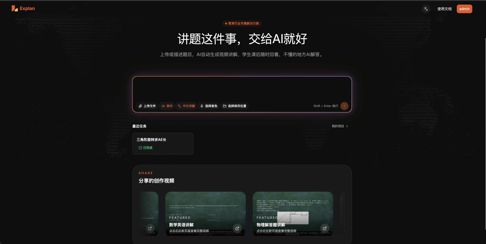
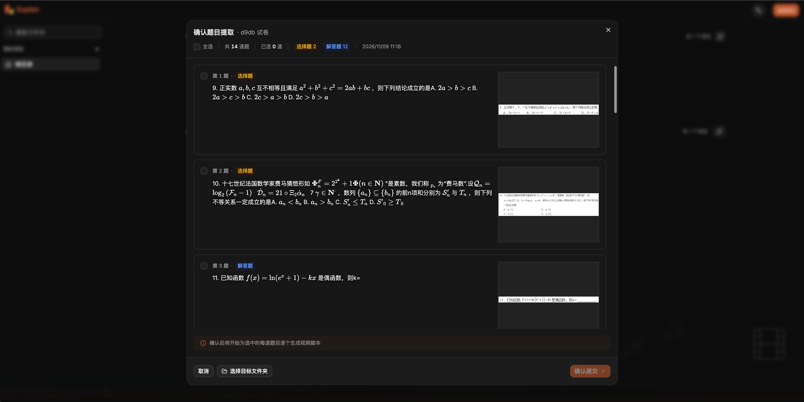
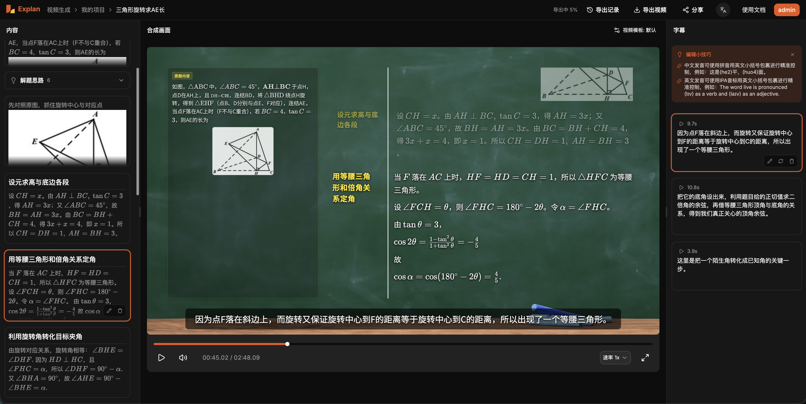
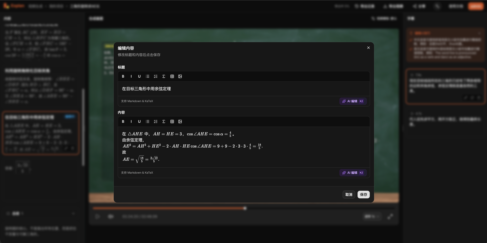
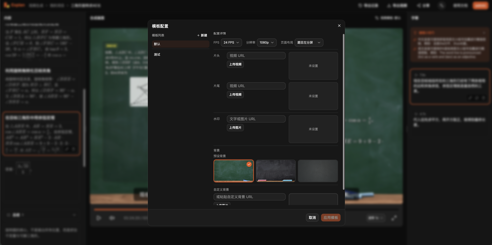
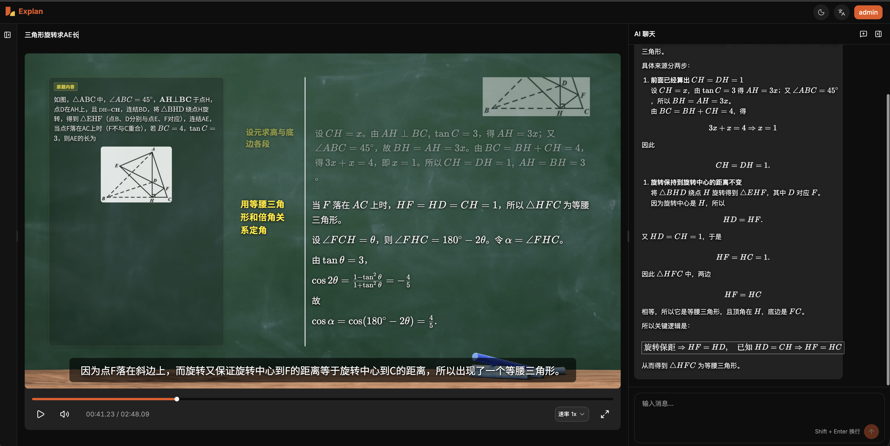
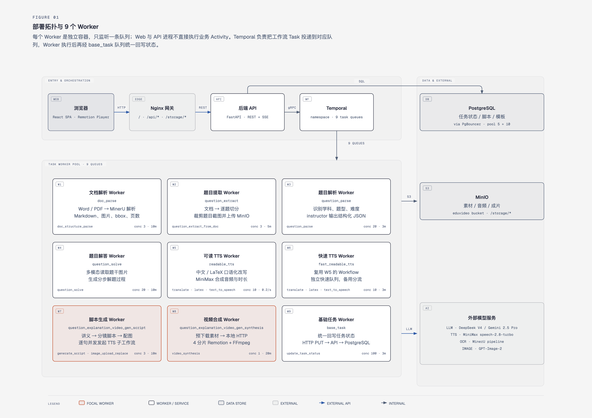
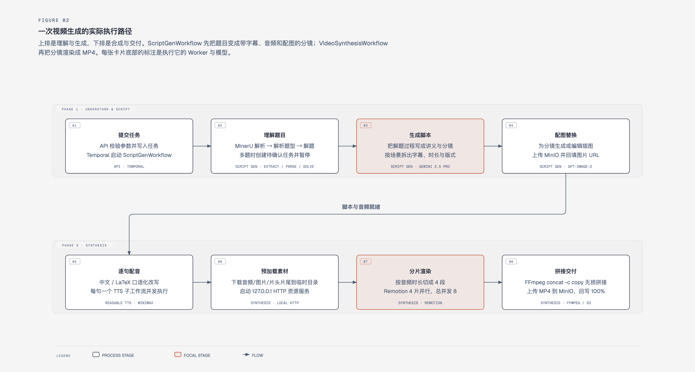
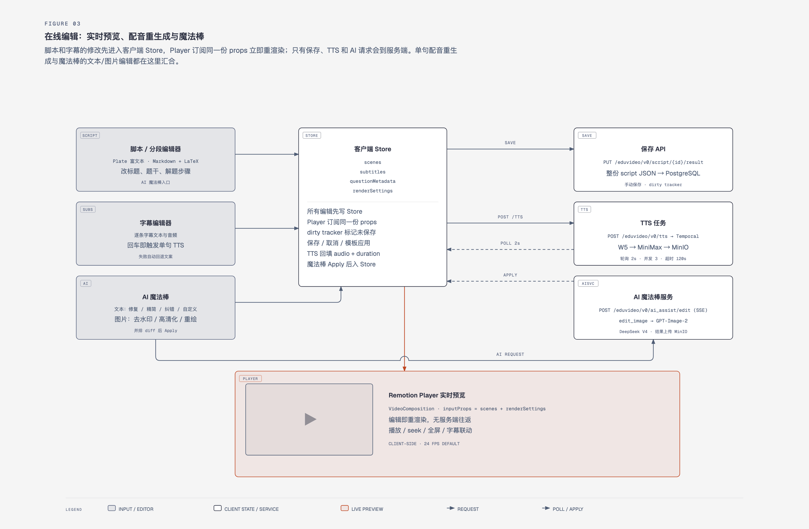

<div align="center">

# EduVideo

**把一道题，变成一堂讲得清楚的视频课。**

上传题目、试卷或文档，AI 自动完成理解、解题、写脚本、配图、配音与渲染，产出可直接播放、分享的题目讲解视频。

[](https://github.com/wan-h/eduvideo/actions/workflows/cicd.yml)
[](LICENSE)
[](#快速开始)
[](backend/pyproject.toml)
[](frontend/eduvideo/package.json)

[功能特性](#功能特性) · [产品截图](#产品截图) · [架构设计](#架构设计) · [快速开始](#快速开始) · [开发指南](docs/development.md) · [在线体验](https://eduvideo.light4ai.com)

</div>

---

## 简介

EduVideo 是面向教学场景的「题目讲解视频」生成平台。老师只需上传题目截图、试卷或文档，平台会自动完成题目提取、结构化解析、分步解答、讲义与分镜撰写、配图生成、逐句配音和视频渲染，最终输出可直接播放、分享的讲解视频；学生可以在分享页观看，并就讲解内容继续向 AI 追问。

从上传到成片的每一步都由 Temporal 编排，长任务可重试、可观测；成片支持 **实时在线编辑**——脚本、字幕、公式与版式边改边看，改一句字幕只重建这一句配音，无需整条视频重新生成，这在同类产品中并不多见；渲染基于 Remotion，公式（KaTeX）、字幕、板书与音频严格对齐。

## 在线体验

在线体验地址：<https://eduvideo.light4ai.com>

> 在线体验版主要用于快速了解产品形态，部署版本滞后于开源仓库，部分能力尚未上线；API限流，多人同时使用时可能超时失败；本仓库的开源版本包含更多特性与最新修复，功能与配置请以开源版本为准。


## 演示视频

https://github.com/user-attachments/assets/2e20719e-2fbd-4dbd-aca3-352297ab131e

## 产品截图

<table>
  <tr>
    <td width="50%" align="center" valign="top">
      
      <br />
      <sub><b>首页</b> · 上传文件或直接描述题目，选择学段、讲解语言与音色</sub>
    </td>
    <td width="50%" align="center" valign="top">
      
      <br />
      <sub><b>多题确认</b> · 整卷解析后逐题核对，勾选即批量生成</sub>
    </td>
  </tr>
  <tr>
    <td width="50%" align="center" valign="top">
      
      <br />
      <sub><b>编辑工作台</b> · 左侧脚本分镜、中间 Remotion 实时预览、右侧逐条字幕</sub>
    </td>
    <td width="50%" align="center" valign="top">
      
      <br />
      <sub><b>内容编辑</b> · 标题与解题步骤支持 Markdown + KaTeX，可一键交给 AI 改写</sub>
    </td>
  </tr>
  <tr>
    <td width="50%" align="center" valign="top">
      
      <br />
      <sub><b>模板配置</b> · 片头片尾、水印、背景、分辨率、FPS 与页面布局</sub>
    </td>
    <td width="50%" align="center" valign="top">
      
      <br />
      <sub><b>分享与追问</b> · 成片在线播放，观众可就讲解内容继续向 AI 提问</sub>
    </td>
  </tr>
</table>

## 功能特性

**内容生成**

- **文档与图片解析**：Word / PDF / 图片经 MinerU 转为 Markdown，保留图片、bbox 与页数信息。
- **题目提取**：整份试卷逐题切分，自动裁剪题目截图并上传对象存储。
- **结构化解析**：识别学科、题型与难度，用 instructor 输出稳定 JSON。
- **分步解答**：多模态读取题干与配图，生成可教学的解题过程。
- **脚本与分镜**：把解题过程写成讲义与分镜，按场景拆出字幕、时长与版式。
- **配图生成与编辑**：按分镜生成或编辑插图，回填图片 URL 后进入渲染。
- **多题确认**：多题场景先生成待确认任务并暂停，人工勾选后再批量出片。

**配音与渲染**

- **LaTeX 口语化**：公式先改写为可朗读文本再合成，避免「念公式」式的机械配音。
- **TTS 与音色克隆**：默认 MiniMax `speech-2.8-turbo`，支持上传样本克隆专属音色。
- **分片并行渲染**：按音频时长切片，Remotion 多片并行（默认 4 片 / 总并发 8）。
- **无损拼接**：FFmpeg `concat -c copy` 拼接，渲染进度实时回写。

**在线编辑**

- **实时预览**：编辑先写入客户端 Store，Remotion Player 订阅同一份 props 立即重渲染，不打扰服务端。
- **单句重配音**：字幕逐条编辑，回车即触发该句的 TTS 重建。
- **AI 魔法棒**：文本修复 / 精简 / 纠错 / 自定义，图片去水印 / 高清化 / 重绘，并排 diff 后应用。
- **模板配置**：背景、片头片尾、水印、分辨率、FPS 与页面布局可配置。

**平台能力**

- **Temporal 编排**：9 条独立队列 + 9 个 Worker 容器，任务可重试、可观测、可水平扩容。
- **对象存储**：S3 兼容（MinIO），`storage-init` 自动建桶并设置匿名只读策略。
- **国际化**：中英文界面切换，分享页同样支持。
- **一键部署**：docker compose 拉起 Nginx + API + Workers + Temporal + PostgreSQL + MinIO 完整栈。

## 架构设计

浏览器访问 nginx 统一入口，静态资源、API 与对象存储分别转发；FastAPI 只负责参数校验与工作流提交，真正的耗时任务由 Temporal 投递到 9 条队列，交由 9 个独立 Worker 容器执行后再回写状态。

[](docs/images/architecture-workers.png)

一次视频生成的完整执行路径：前半段把题目变成带字幕、音频和配图的分镜，后半段把分镜渲染成 MP4。

[](docs/images/architecture-pipeline.png)

编辑器中的脚本、字幕与 AI 建议先落在客户端 Store，Player 实时重渲染；只有保存、TTS 和 AI 请求会回到服务端。

[](docs/images/architecture-editing.png)

> 以上图示来自 [架构详解（HTML）](docs/eduvideo-architecture.html)，下载后用浏览器打开可查看全部细节：Worker 并发、超时、接口路径与轮询策略。

## 技术栈

| 层次 | 选型 |
|---|---|
| 前端 | React 19 · TypeScript · Vite · Remotion Player · Tailwind CSS v4 · shadcn/ui · Zustand · TanStack Query · Plate（Markdown + KaTeX） |
| 后端 | Python 3.12 · FastAPI · Temporal · SQLAlchemy · Alembic · Pydantic |
| 视频渲染 | Remotion 4（服务端渲染）· FFmpeg |
| 存储 | PostgreSQL 18 · PgBouncer · MinIO（S3 兼容） |
| 模型服务 | DeepSeek（文本理解与生成）· MiniMax `speech-2.8-turbo`（TTS / 音色克隆）· 阿里云百炼 `wan2.6`（配图）· MinerU（文档解析） |
| 部署 | Docker Compose · Nginx · GitHub Actions（多架构镜像推送） |

## 快速开始

**前置要求**：Docker 24+ 与 Compose v2；可用的文本模型、TTS、配图与文档解析 API Key。

```bash
git clone https://github.com/wan-h/eduvideo.git
cd eduvideo/docker
cp .env.example .env
```

`docker/.env` 中**唯一必填的是 `LLM_*_API_KEY`**；其余变量已预填本地部署默认值，本地启动无需修改：

| 变量 | 说明 |
|---|---|
| `LLM_*_API_KEY`（**必填**） | 各环节模型密钥：文本任务（DeepSeek）、TTS 与音色克隆（MiniMax）、配图（阿里云百炼）、文档解析（MinerU）；留空的模型会在对应环节失败 |
| `POSTGRES_PASSWORD`、`STORAGE_ROOT_PASSWORD` | 已预填本地开发默认值，本地部署无需修改；生产环境务必替换 |
| `PUBLIC_HOST` | 已预填 `localhost`，本地部署无需修改；部署到服务器时改为域名或服务器 IP。前端页面、预签名 URL 与 `STORAGE_DOMAIN` 均以它为基准，**必须同时被浏览器与渲染容器访问到** |

> **关于 `LLM_*_API_KEY`**：文本与配图类模型（题目解析、解答、脚本生成、翻译、对话、文生图等）统一通过 openai 库按 OpenAI 协议接入，因此凡兼容该协议的模型服务（DeepSeek、OpenAI、本地 Ollama / vLLM、其他云厂商等）均可接入——把对应的 `LLM_*_BASE_URL` 与 `LLM_*_MODEL` 指向目标服务并填写其 `LLM_*_API_KEY` 即可，无需修改代码；TTS 与文档解析（MinerU）仍走各自厂商的专用接口。

启动：

```bash
docker compose up -d     # 首次会拉取镜像并初始化仓库根目录的 volumes/db、volumes/minio
docker compose ps        # 等待各服务变为 healthy
```

首次启动时两个一次性服务会先执行：`storage-init` 创建 bucket 并设置匿名只读策略，`srv-education-api-migrate` 执行数据库迁移；两者成功后 API 与 Workers 才会启动。

| 入口 | 地址 |
|---|---|
| 前端 | <http://localhost> |
| 接口文档（Swagger） | <http://localhost/docs> |
| 对象存储控制台 | <http://localhost:9001> |
| Temporal UI | <http://localhost:8080> |

```bash
docker compose logs -f srv-education-api     # 查看 API 日志
docker compose down                          # 停止（保留数据）
```

> 端口、日志、数据目录、本地热更新开发、配置优先级、数据库迁移、镜像构建与常见问题，见 **[开发指南](docs/development.md)**。

## 项目结构

| 路径 | 说明 |
|---|---|
| `backend/` | FastAPI 服务、Temporal Workflow / Activity 与各队列 Worker、Remotion 渲染模板 |
| `frontend/eduvideo/` | React SPA 与 pnpm workspace（主应用、`shared` 视频组件、`server` 渲染服务） |
| `docker/` | Compose 编排（完整栈 / 中间件）、nginx 与对象存储初始化配置、环境变量模板 |
| `docs/` | 开发指南、架构详解与截图资源 |
| `volumes/` | 本地运行产生的数据（数据库、对象存储，已被 `.gitignore` 忽略） |

## 文档

- [开发指南](docs/development.md)：本地开发、配置说明、数据库迁移、代码质量、镜像与发布、常见问题
- [架构详解](docs/eduvideo-architecture.html)：部署拓扑、9 条队列、生成流水线与在线编辑链路
- [后端说明](backend/README.md) · [前端说明](frontend/eduvideo/README.md) · [任务队列说明](backend/src/tasks/README.md)

## 贡献

欢迎提交 Issue 与 Pull Request。提交前请在 `backend/` 执行 `uv run ruff check . && uv run ruff format --check . && uv run pytest`，在 `frontend/eduvideo/` 执行 `pnpm lint && pnpm typecheck && pnpm test`；CI 会对 PR 按改动范围执行同样的检查。首次在本地运行后端检查前，先复制 `backend/configs/config.example.yaml` 为 `backend/configs/config.dev.yaml` 并补全各模型 API Key（该文件已被 `.gitignore` 忽略）。

## 加入社区群

微信扫码添加加入社区群，备注 **eduvideo**。

<div align="center">
  
</div>

## 许可证

本项目基于 [Apache License 2.0](LICENSE) 开源，版权归开源作者所有。

**转载、镜像、分发与二次发布须注明出处。** 任何形式的再发布（无论是否修改），都必须保留 [NOTICE](NOTICE) 文件，并在文档、产品「关于」页或通常展示第三方声明的位置，以可读形式明确标注：

> EduVideo · <https://github.com/wan-h/eduvideo>

对源码的任何修改，还须在对应文件中显著标明「已被修改」。这两项不是请求，而是 Apache 2.0 第 4(b)、4(d) 条的强制条件——不在再发布中保留 `NOTICE` 中的署名，即构成对本协议的违反。

如计划把本项目或其衍生版本用于商业产品、商业部署，或以自有品牌对外发布，请先通过 [Issue](https://github.com/wan-h/eduvideo/issues) 与作者联系，说明使用场景并确认署名方式。
